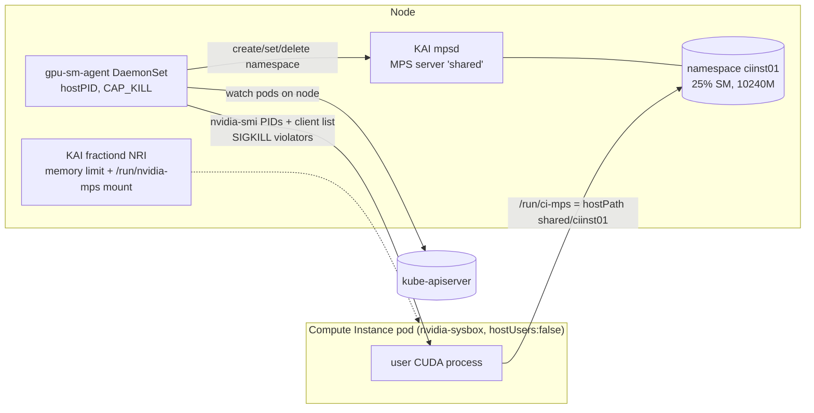

# GPU Fractioning for Sysbox Compute Instances

> Test report and design, based on experiments on node `dev03`, 2026-11-13.
> Status: **prototype**. It works and has been measured, but it is not production-hardened (see [§9 Known issues](#9-known-issues)).

---

## 1. Summary

The goal was to give each Sysbox-based Compute Instance a **fraction of one GPU** with both a **memory** limit and a **compute** limit that a root user inside the instance cannot raise.

| Question | Answer |
|---|---|
| Does Sysbox work with GPU fractioning? | **Yes**, through a chained runtime (`nvidia-sysbox`). Plain `sysbox-runc` gets no GPU. |
| Memory limit | **Yes.** KAI `gpu-fraction` / `gpu-memory`, 1 MiB granularity, enforced on the host side (root inside the container cannot bypass it). |
| Compute limit, out of the box | **No.** Run:ai 3.0 `NvFractions` caps memory only. Under contention the GPU is split evenly regardless of fraction. |
| Compute limit, with `gpu-sm-agent` (this repo) | **Yes.** MPS protocol-3 namespaces with a host-set SM percentage, about 1 SM per 1 %. Verified 1:3 split under contention. |
| Can root inside Sysbox get around it? | Overriding env vars or limits: no. Skipping MPS or joining another namespace: the agent kills the process within ~0.5–1 s. |
| Open bug | Under Sysbox, KAI's memory accounting sometimes applies **another pod's** memory limit (6 of 56 pods in fast churn tests). The agent prevents *over*-allocation, but can't prevent *under*-allocation. See [§9.1](#91-kai-memacct-applies-a-stale-memory-limit-under-sysbox). |

Recommended stack for a GPU Compute Instance:

```
memory   : KAI gpu-fraction / gpu-memory           (driver-side memacct, exact reported size)
compute  : gpu-sm-agent → MPS namespace per pod    (active-thread-percentage, host-set)
runtime  : RuntimeClass nvidia-sysbox, hostUsers: false
scheduler: runai-scheduler (KAI), Run:ai project namespace
```

---

## 2. Environment and versions

| Component | Version |
|---|---|
| OS / kernel | Ubuntu 24.04.5 LTS / 6.8.0-147-generic |
| Kubernetes | RKE2 v1.36.5+rke2r1 |
| containerd | 2.3.4-k3s1 (NRI enabled, config version 3) |
| GPU | 1× NVIDIA A100-SXM4-40GB (108 SMs, 40960 MiB, VBIOS 92.00.45.00.03), MIG disabled |
| NVIDIA driver | 615.71.09 (CUDA UMD 13.4) |
| CUDA MPS control | binary version 13040, protocol 3 |
| NVIDIA GPU Operator | v26.7.1 |
| NVIDIA Container Toolkit | 1.20.1 (CDI mode) |
| NVIDIA device plugin / GFD | v0.20.1 |
| DCGM exporter | 4.6.1-4.8.4 |
| MIG manager | v0.15.1 |
| Run:ai (self-hosted) | 3.0.20 |
| KAI scheduler (scheduler, binder, admission, operators) | v0.18.3 |
| KAI gpu-fractioning (operator, fractiond, mpsd, metricsd) | v0.1.6 |
| Sysbox CE | 0.7.1 (commit 081856cc5d17e7095f066b08d0eca6bb0b515c47) |
| Test image | `nvcr.io/nvidia/pytorch:26.09-py3` (torch 2.14.0a0+b2c75dd062.nv26.09, CUDA 13.4.1) |
| Probe workload | fp32 `torch.mm`, 8192×8192, looped for 20 s |

> **HAMi is no longer installed.** The HAMi fields in [`main.md`](main.md) §5 (`nvidia.com/gpumem`, `nvidia.com/gpucores`) do not apply on this cluster. The node only advertises `nvidia.com/gpu: 1`.

---

## 3. How GPU sharing works in Run:ai 3.0 / KAI

KAI's `configs.kai.scheduler` has a `global.gpuSharingMode` preset:

| Mode | Memory | Compute | Mechanism |
|---|---|---|---|
| `NonMemoryEnforced` | scheduling only, no cap | – | trust-based packing |
| **`NvFractions`** (this cluster) | ✅ host-side | ❌ | MPS memory accounting (`memacct`) + `fractiond` NRI plugin |
| `HamiCore` | ✅ | ✅ (soft) | HAMi-core `libvgpu.so`, CUDA interception inside the container (kernel-launch throttling) |
| `Disabled` | – | – | – |

Inside `NvFractions`:

- **Admission** turns `gpu-fraction` / `gpu-memory` annotations into `nvidia.com/container.<c>.gpu-memory.request` and sets `runtimeClassName: nvidia`. It does not override a different runtime class that is already set.
- **fractiond** (NRI plugin) adds `CUDA_MPS_PIPE_DIRECTORY`, `NVIDIA_GPU_MEMORY_LIMIT/REQUEST`, `NVIDIA_VISIBLE_DEVICES=<CDI device>` and mounts `/run/nvidia-mps` at container creation. It adds no OCI hooks.
- **mpsd** runs `nvidia-cuda-mps-control` in multi-user mode with one root server, `shared`, and one namespace, `default` (100 %, unlimited). `context-share default_socket=off`: a client that connects to the root socket gets memory accounting but a *native* CUDA context (log: "fallback to normal CUDA operation").
- **Compute modes** (annotation `nvidia.com/container.<c>.gpu-compute.mode`):
  - default `time-slicing`: native contexts, driver round-robin;
  - `sm-sharing`: the client joins the `default` MPS namespace, so pods run concurrently but with no cap.

**Driver time-slicing is not weighted.** `nvidia-smi compute-policy` only changes the slice length for the whole GPU (`Timeslice: Default`), not per process. Weighted time-slicing (Run:ai's Fair/Strict modes) needs a component that gates kernel submission, i.e. CUDA interception (`HamiCore`). `NvFractions` doesn't have one.

---

## 4. Sysbox + GPU: making it work

Files: [`node-setup/`](../node-setup/).

| Attempt | Result |
|---|---|
| `runtimeClassName: sysbox-runc` + `gpu-fraction` | ❌ KAI schedules the pod and fractiond injects the MPS env and mount, but **no GPU** (`Found no NVIDIA driver`). A fractional pod receives its GPU only through `nvidia-container-runtime` reading `NVIDIA_VISIBLE_DEVICES=<CDI name>`. |
| Pod annotation `cdi.k8s.io/gpu: <CDI name>` with `sysbox-runc` | ❌ containerd reads CDI annotations from the *container* config, and kubelet doesn't copy pod annotations there. |
| **`nvidia-sysbox`**: `nvidia-container-runtime` (CDI mode) with `runtimes = ["sysbox-runc"]` | ✅ GPU injected, then Sysbox runs the container with user namespaces. |

`nvidia-sysbox` is a separate runtime with its own wrapper (`/usr/local/bin/nvidia-sysbox-runtime`) and config (`/etc/nvidia-sysbox/config.toml`). The GPU-operator-managed `nvidia` runtime is untouched. The containerd drop-in lives in `/var/lib/rancher/rke2/agent/etc/containerd/config-v3.toml.d/`, which RKE2 keeps across config regeneration.

With `hostUsers: false`, container root maps to a random host UID range (e.g. `0 → 941555712`, 65536 IDs). MPS multi-user mode accepts these UIDs.

---

## 5. Memory (KAI `NvFractions`)

### 5.1 Granularity

| Request | KAI annotation | Device reports | Usable (allocation loop) |
|---|---|---|---|
| `gpu-fraction: "0.01"` | 409Mi | – | too small: CUDA context + PyTorch init alone runs out of memory |
| `gpu-fraction: "0.05"` | 2Gi | 2.0 GiB | 1.56 GiB |
| `gpu-fraction: "0.25"` | 10Gi | 10.0 GiB | 9.56 GiB |
| `gpu-fraction: "0.33"` | 13516Mi | 13.2 GiB | 12.75 GiB |
| `gpu-fraction: "0.777"` | 31948Mi (rounded to 0.78) | 31.2 GiB | 30.75 GiB |
| `gpu-memory: "1000"` | 1000Mi | 1000 MiB | (PyTorch init fails) |
| `gpu-memory: "1500M"` / `"3G"` / `"2.5Gi"` | rejected by admission webhook (`strconv.ParseUint`) | – | – |

- `gpu-fraction` is rounded to **2 decimals**, about 409 MiB steps on 40 GiB.
- `gpu-memory` is an **integer number of MiB**, so 1 MiB steps.
- About 0.45 GiB of each slice is taken by the CUDA context. `cudaMemGetInfo` reports the reduced total, so frameworks that size themselves from free memory (vLLM, etc.) behave correctly.

### 5.2 Enforcement: root inside Sysbox

All of these were run as uid 0 in a `nvidia-sysbox` pod with `hostUsers: false`, fraction 0.25:

| Attempt | Result |
|---|---|
| Unset `CUDA_MPS_PIPE_DIRECTORY`, `NVIDIA_GPU_MEMORY_LIMIT/REQUEST` | capped at 10 GiB |
| Point the pipe at a fake directory | capped |
| `umount /run/nvidia-mps` + tmpfs over it | capped |
| All of the above, launched without a shell (`/usr/bin/env -u … python`) so the image's `cudaCheck` never runs | capped |

So the memory cap is enforced outside the container: the MPS control daemon tracks clients by cgroup (`memacct: Tracking mps client … cgroup_fd=present`). **But see [§9.1](#91-kai-memacct-applies-a-stale-memory-limit-under-sysbox).**

---

## 6. Compute without the agent

fp32 matmul TFLOPS, A100-40GB (one pod alone: ~124).

| Scenario | Pod 1 | Pod 2 | Notes |
|---|---|---|---|
| Any fraction alone (0.05 – 0.78) | ~124 | – | all 108 SMs, not capped |
| 2 × 0.5, time-slicing | 56.2 | 56.2 | even split, ~10 % context-switch overhead |
| 0.25 vs 0.75, time-slicing | 56.2 | 56.3 | **fraction ignored** |
| 2 × 0.5, `sm-sharing` | 59.0 | 59.1 | concurrent (`M+C`), ~5 % more total |
| 0.25 vs 0.75, `sm-sharing` | 58.6 | 58.6 | fraction ignored |
| User sets `CUDA_MPS_ACTIVE_THREAD_PERCENTAGE=25` | 35.4 (26 SMs) | – | voluntary; the user can unset it |

---

## 7. `gpu-sm-agent`: per-pod SM caps

Files: [`images/gpu-sm-agent/`](../images/gpu-sm-agent/). Example pod: [`manifests/pod-gpu-fraction-sm.yaml`](../manifests/pod-gpu-fraction-sm.yaml).

### 7.1 The MPS feature it uses

Driver 615 ships MPS **protocol 3** (`nvidia-cuda-mps-control -p 3`). It supports named namespaces on a server, each with its own socket directory and limits:

```bash
export CUDA_MPS_PIPE_DIRECTORY=/run/nvidia-mps
nvidia-cuda-mps-control -p 3 namespace create ciinst01 --server=shared
nvidia-cuda-mps-control -p 3 namespace set ciinst01 --server=shared \
    --active-thread-percentage=25 --pinned-memory-limit=10240M
# socket: /run/nvidia-mps/shared/ciinst01/control
```

- Namespace names must be alphanumeric (`[a-z0-9]`, `-` and `_` are rejected), up to about 32 characters.
- Static SM partitions also exist (`sm-partition`, 54 chunks of 2 SMs on A100), not tested.

The agent adds namespaces to **KAI's existing `shared` server**, so KAI's `mpsd` keeps running.

### 7.2 Design



**What the platform puts on the pod** (users never write this themselves):

```yaml
metadata:
  annotations:
    gpu-fraction: "0.25"          # KAI: memory
    ci.gpu/sm-percent: "25"       # agent: SM %
    ci.gpu/mps-ns: "ciinst01"     # agent: namespace, ci[a-z0-9]{0,28}, unique per node
spec:
  runtimeClassName: nvidia-sysbox
  hostUsers: false
  volumes:
    - name: ci-mps
      hostPath: {path: /run/nvidia-mps/shared/ciinst01, type: Directory}
  # container: mount at /run/ci-mps, export CUDA_MPS_PIPE_DIRECTORY=/run/ci-mps
```

**Every 0.5 s the agent:**

1. Lists pods on its node and keeps those with valid `ci.gpu/*` annotations. Bad names, bad percentages and duplicate namespaces are rejected and logged. It waits until KAI has written `gpu-memory.request`.
2. **Reconciles namespaces:** creates missing ones, sets `active-thread-percentage = sm-percent` and `pinned-memory-limit = KAI memory`, and deletes `ci*` namespaces whose pod is gone.
3. **Enforces:** for every GPU process (`nvidia-smi -q -d PIDS`, host PIDs) whose `/proc/<pid>/cgroup` belongs to an enforced pod:
   - type `C` (native context, skipped MPS) → `SIGKILL`;
   - type `M+C` but `client list` shows a different namespace → `SIGKILL`;
   - type `M+C` not yet listed → 4 ticks of grace, then `SIGKILL`.

**Startup ordering:** the hostPath uses `type: Directory`, and kubelet retries the mount until the agent has created the namespace. So the container never starts without its cap.

### 7.3 Holes found and closed

| Hole | Fix |
|---|---|
| Root skips MPS (`CUDA_MPS_PIPE_DIRECTORY=/nonexistent`), gets a native context with all 108 SMs | agent kills processes of type `C` |
| fractiond mounts the **whole** `/run/nvidia-mps` tree, including `shared/default` (100 %) and every other pod's namespace socket | agent checks each client's actual namespace (`client list`) |
| `EXCLUSIVE_PROCESS` compute mode as an alternative | ❌ doesn't work: the MPS server only holds the GPU while it has clients, so a native process takes it when the GPU is idle |
| Hiding `/dev/nvidia0` so native contexts can't be created | ❌ MPS clients need it too. `mknod` is blocked in the user namespace. |
| Agent's `kill` got `EPERM` | containerd's default AppArmor profile only allows signals to peers with the same profile. Agent runs `appArmorProfile: Unconfined` (capabilities stay limited to `KILL`, `DAC_OVERRIDE`). |
| A workload sets `ci.gpu/sm-percent` higher than its memory fraction (self-service compute) | agent clamps SM% to `ceil(mem/gpu_total*100)+slack`; see security-testing.md §6b |
| NGC images run `/usr/local/bin/cudaCheck` from shell init, which opens a native context | killed by the agent (harmless). The Compute Instance image doesn't have it. |

---

## 8. Test results with the agent

All pods: `nvidia-sysbox`, `hostUsers: false`, KAI fraction + `ci.gpu/*`.

### 8.1 Correctness: 8 sequential pods

| Fraction / SM % | SMs | Reported | Usable | TFLOPS alone |
|---|---|---|---|---|
| 0.25 / 25 % | 26 | 10.0 GiB | 9.88 GiB | 35.2 |
| 0.5 / 75 % | 80 | 20.0 GiB | 19.69 GiB | 100.2 |
| 0.1 / 10 % | 10 | 4.0 GiB | 3.94 GiB | 13.6 |
| 0.75 / 50 % | 54 | 30.0 GiB | 29.75 GiB | 73.5 |

The SM count was right in every run. SM mapping: 10 % → 10, 25 % → 26, 50 % → 54, 75 % → 80.

### 8.2 Contention

| Pods running together | SMs | Memory cap | TFLOPS |
|---|---|---|---|
| A: 25 % · B: 75 % (either start order) | 26 · 80 | 9.88 · 24.69 GiB | **29.7 · 90.2** (1:3) |
| Same, with the GPU in `EXCLUSIVE_PROCESS` | 26 · 80 | same | 29.7 · 90.1 |

### 8.3 Bypass attempts (root in Sysbox)

| Attempt | Without agent | With agent |
|---|---|---|
| `CUDA_MPS_ACTIVE_THREAD_PERCENTAGE=100` | ignored (26 SMs) | ignored |
| `CUDA_MPS_PINNED_DEVICE_MEM_LIMIT=0=40G` | ignored | ignored |
| Skip MPS (native context) | **108 SMs** | killed (`native GPU context (type C)`) |
| Join `shared/default` or another pod's namespace | **possible** | killed (`MPS client in namespace …`) |
| Look for other namespaces | only via fractiond's `/run/nvidia-mps` mount | – |

### 8.4 Memory under churn (Sysbox)

| Run | Agent memory mirror | Pods | Over-allocated | Under-allocated |
|---|---|---|---|---|
| KAI only, `nvidia-sysbox` | – | 12 | **1** (4 → 30 GiB) | 1 (30 → 20 GiB) |
| KAI + agent (SM only) | no | 8 | 0 | 1 (30 → 4 GiB) |
| KAI + agent (SM only), UID-base check | no | 10 | **1** (4 → 10 GiB) | 0 |
| KAI + agent | **yes** | 14 | **0** | 2 (30 → 10, 30 → 4 GiB) |
| KAI + agent | yes | 12 | 0 | 0 |
| KAI only, plain `nvidia` runtime (runc) | – | 36 (12 + 24) | 0 | 0 |

---

## 9. Known issues

### 9.1 KAI memacct applies a stale memory limit under Sysbox

**What happens:** a new fractional pod sometimes gets **another pod's** memory limit, both reported and enforced. Examples: 0.1 (4 GiB) got 30 GiB; 0.75 (30 GiB) got 4, 10 or 20 GiB. The stale value is not always the previous pod's; it can come from a pod that ran much earlier.

**Rate:** 6 of 56 pods (about 1 in 9) in fast churn tests (create → finish → delete → next) under Sysbox; **0 of 36** on the plain `nvidia` runtime (runc) under the same churn.

**Probable cause (not confirmed):**
- Under Sysbox, container processes live in a nested cgroup, `…/cri-containerd-<id>.scope/init.scope`.
- Under runc they live directly in `…/cri-containerd-<id>.scope`.
- KAI tracks MPS clients by cgroup (`memacct: Tracking mps client … cgroup_fd=present`), so it may be failing to find the container's limit at the nested path and using a leftover value.
- I tried to confirm this by moving the process to the container root cgroup, but the write to `cgroup.procs` failed (`rc=1`), so the hypothesis is untested. In the systemd Compute Instance image, processes will be nested even deeper (`init.scope/system.slice/…`, `user.slice/…`).

**Mitigation in place:** the agent mirrors KAI's value onto the MPS namespace as `pinned-memory-limit`, so the effective cap is the lower of the two. **No over-allocation** has been seen since (0/26). **Under-allocation remains**: a pod can get less than it asked for, and its reported total is wrong.

**Next steps:**
- Report upstream to KAI gpu-fractioning (v0.1.6), with the repro in [`testing/gpu-fractioning/churn-kai.sh`](../testing/gpu-fractioning/churn-kai.sh).
- Agent idea: detect it by running a short probe in the pod's namespace at startup and reading `cuMemGetInfo`, then restart the pod if the value is wrong.

### 9.2 Kill latency and retry bursts

A process that bypasses MPS runs for up to ~0.5–1 s (one tick plus the `nvidia-smi` call) before it is killed. A user retrying in a loop gets repeated short full-GPU bursts. Planned: evict the pod after N kills, which needs `pods/eviction` RBAC.

### 9.3 Not tested yet

- Restart of KAI's `mpsd`: this drops all namespaces. The agent recreates them, but running pods keep a bind mount to the old directory and probably need a restart.
- The real `sysbox-ssh-kube-cpu-aware` (systemd) image under `nvidia-sysbox`. Its entrypoint must export `CUDA_MPS_PIPE_DIRECTORY=/run/ci-mps` for SSH sessions, replacing the value fractiond injects.
- Multi-GPU nodes and MIG.
- Static `sm-partition` (hard SM partitions in 2-SM chunks) instead of thread percentage.

### 9.4 Small notes

- An MPS namespace's `pinned-memory-limit` caps allocation, but the device then reports the full 39.5 GiB, unlike KAI's memacct. This is why KAI stays the source of the reported size.
- The agent needs `hostPID`, `CAP_KILL`, `CAP_DAC_OVERRIDE` and an unconfined AppArmor profile, plus cluster-wide `get/list/watch pods`. Treat it like other node agents.

---

## 10. Reproduce

```bash
# node setup (restarts rke2-server, no reboot)
bash node-setup/install.sh

# agent
kubectl apply -f images/gpu-sm-agent/daemonset.yaml
kubectl -n gpu-sm-agent create configmap gpu-sm-agent \
  --from-file=images/gpu-sm-agent/agent.py --dry-run=client -o yaml | kubectl apply -f -

# probe (Run:ai project namespace)
cd testing/gpu-fractioning
kubectl -n runai-llm-team create configmap frac-probe --from-file=frac-probe.py=probe.py
bash mk-ci-pod.sh t1 0.25 25 cit1 '[{name: DWELL, value: "20"}]' | kubectl apply -f -
bash wait-ci.sh t1          # RESULT {"SMs": 26, "total_GiB": 10.0, "alloc_max_GiB": 9.875, "TFLOPS": 35.4}

# stale-limit repro (KAI only)
RC=nvidia-sysbox bash churn-kai.sh kc 12 '["python","/probe/frac-probe.py"]'
RC=""            bash churn-kai.sh kr 12 '["python","/probe/frac-probe.py"]'
```

Inspecting MPS state:

```bash
export CUDA_MPS_PIPE_DIRECTORY=/run/nvidia-mps
sudo -E nvidia-cuda-mps-control -p 3 namespace list
sudo -E nvidia-cuda-mps-control -p 3 client list --all --format=csv
kubectl -n gpu-sm-agent logs ds/gpu-sm-agent | grep -E 'kill|reject|error'
```

Rollback: `kubectl delete -f images/gpu-sm-agent/daemonset.yaml`, then `bash node-setup/uninstall.sh`.
